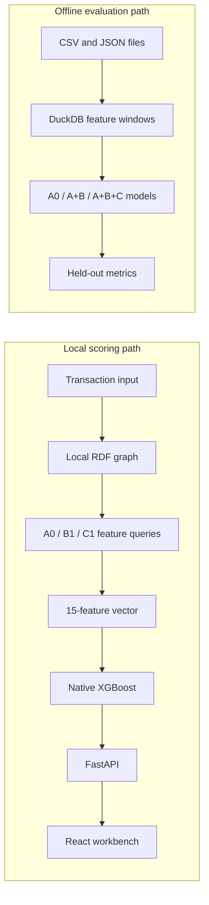

# Graph-Enriched Fraud Scoring

Fraud scores get more useful context when they can look beyond a transaction's
amount and static customer details. This project builds a local scoring path
that adds card and merchant history through RDF/SPARQL, then passes the
resulting features to XGBoost, FastAPI, and a React workbench.

This is a focused implementation of one fraud-scoring use case, not a port of an
enterprise application or a like-for-like replacement for the platforms used
in the wider workflow. The [project story](PROJECT_STORY.md) explains what we
built, why we built it in stages, and what the current evidence does and
doesn't support.

## How it fits together



The two paths are intentionally separate today: scoring queries RDF, while the
exploratory feature-stage evaluation uses DuckDB over flat files.

## The engineering path

1. Define a stable feature contract so data retrieval and inference agree on
   feature names, ordering, units, and defaults.
2. Add earlier card history and time-lagged merchant aggregates without using
   future transactions.
3. Query a minimal RDF representation for scoring-time features and return the
   supporting evidence with the prediction.
4. Isolate model inference behind a local API and provide a small React scoring
   workbench.
5. Compare A0, A+B, and A+B+C feature stages under a shared chronological
   evaluation protocol.

The graph path makes relationships and time rules explicit. That's the idea
we're testing, not proof that graphs improve fraud detection. The current large
evaluation computes history features with DuckDB from flat files; it tests the
feature stages, not RDF-versus-SQL performance.

## Platform context

The original solution used Graph Studio, AI Studio, AI Hub, and Mendix for
different parts of its workflow. This repository is not a port: it rebuilds
one scoring flow with smaller local tools:

| Earlier role | Local implementation here | Scope boundary |
| --- | --- | --- |
| [Graph Studio](https://www.siemens.com/en-us/products/rapidminer/graph-studio/) | RDFLib and SPARQL for local feature queries | Small in-memory graph path; no persistent graph platform parity |
| [AI Studio](https://www.siemens.com/en-us/products/rapidminer/ai-studio/) | Python/XGBoost inference and a DuckDB evaluation runner | No managed model-workflow environment; evaluation features are SQL-generated |
| [AI Hub](https://docs.rapidminer.com/latest/hub/) | Local XGBoost provider behind FastAPI | No model registry, managed hosting, scaling, or monitoring service |
| [Mendix](https://www.mendix.com/) | React interface for one scoring flow | No Mendix runtime or full application/workflow parity |

The bundled native model is an owner-authorized conversion of an existing
XGBoost artifact. It is not a newly trained model, and its predictions do not
exactly match the original AI Studio scorer: confidence differed on 30 of 72
synthetic comparison rows, with two binary decision differences. Treat it as a
local demonstration, not production-equivalent scoring.

## What we've checked so far

- The backend suite passes 131 tests with warnings treated as errors.
- The React production build and lint pass; npm audits reported zero
  vulnerabilities at the last check.
- The local scoring path uses RDF-derived feature queries and returns feature
  evidence for a prediction.
- A five-row SQL/RDF smoke comparison matched all 75 feature values, but is too
  small to establish full-data parity.
- The exploratory A0/A+B/A+B+C metrics are withheld. Local dataset files match
  Kaggle version 1 file sizes, but their contents have not been authenticated
  against publisher checksums, and the public metadata does not provide those
  checksums.

No model uplift, graph-over-SQL advantage, production readiness, or exact model
parity is claimed. The tracked graph is invented synthetic fixture data. No raw
transaction dataset is included. See the [evidence report](FastAPI/SCORE_EVIDENCE_INSPECTION.md)
for the evaluation protocol, data caveats, and scan scope.

## Run locally

You'll need Python 3.12 and a Node.js version compatible with Vite in the
lockfile. The API has no authentication and is for local development only; keep
it on loopback.

From the repository root, create the Python environment and start FastAPI:

```powershell
py -3.12 -m venv .venv
.\.venv\Scripts\python.exe -m pip install -r requirements-test.txt
.\.venv\Scripts\python.exe -m uvicorn main:create_app --factory --app-dir FastAPI --host 127.0.0.1 --port 8000
```

In another PowerShell terminal, start the React app:

```powershell
Push-Location fraud-ui
npm ci
npm run dev -- --host 127.0.0.1 --port 5173
Pop-Location
```

Vite proxies `/api` to `http://127.0.0.1:8000` by default. To use another
loopback API port, set `$env:VITE_API_PROXY_TARGET` before starting Vite.

Open <http://127.0.0.1:5173/>. The form loads an example amount, timestamp,
and entity IDs from the local synthetic graph. The score endpoint returns the
prediction, class confidences, historical evidence, and timings. The API schema
is at <http://127.0.0.1:8000/docs>.

## Documentation

- [Project story and engineering decisions](PROJECT_STORY.md)
- [RDF data model and bounded importer](graph/README.md)
- [Training, evaluation, and provenance evidence](FastAPI/SCORE_EVIDENCE_INSPECTION.md)
- [Public release checklist](RELEASE_CHECKLIST.md)